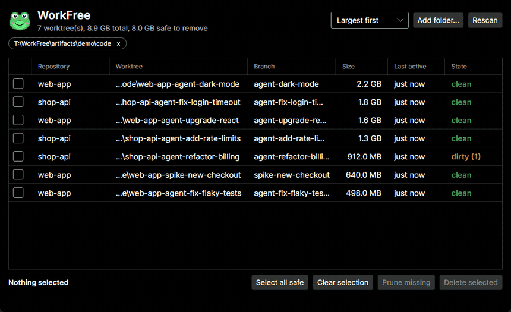

# WorkFree

Find every git worktree on your machine, see how much disk each one uses, and remove the ones you no longer need.



Worktrees pile up quickly, especially when AI coding agents create one per task. WorkFree scans your project folders, shows size, last activity and whether each worktree has uncommitted work, and cleans up safely. It is a single native executable for Windows, macOS and Linux with no runtime to install. It needs `git` on your PATH.

## Desktop app

Run `workfree-gui` (or `workfree gui`) for a window. Add the folder that holds your repositories, tick the worktrees you want gone or press **Select all safe**, then **Delete selected**. It asks before deleting and never removes uncommitted work unless you choose **Force-delete all**. Folders you add are shared with the command-line tool.

The app remembers its last scan, so it opens with that list straight away and checks for changes in the background.

While it works, a small ASCII frog keeps you company: it hops around looking for flies during a scan, then eats one fly for every worktree it removes. The terminal screen shows the same frog.

`workfree-gui` must stay in the same folder as the library files it ships with.

## Terminal

Run `workfree` with no arguments for the interactive screen:

| Key | Action |
| --- | --- |
| up / down, j / k | Move |
| space | Select or unselect |
| a | Select every safe worktree (clean or already missing, not locked) |
| n | Clear the selection |
| d | Delete the selection (asks first) |
| p | Prune records of worktrees whose folders are gone |
| s | Cycle sort: size, age, repo |
| r | Rescan |
| q | Quit |

Or use the commands, which are scriptable:

```bash
workfree list ~/code                      # table of linked worktrees under ~/code
workfree list --json                      # machine-readable
workfree clean ~/code --dry-run           # show what a clean would remove
workfree clean ~/code --older-than 30d    # remove clean worktrees untouched for 30 days
workfree remove path/to/worktree          # remove one worktree
workfree prune ~/code                     # drop records of deleted worktree folders
workfree roots add ~/code                 # search ~/code by default from now on
```

With no directory given, WorkFree searches the roots you configured with `workfree roots add`, or the current directory if there are none.

## Safety

- The main worktree of a repository is never removed.
- Worktrees with uncommitted or untracked files are skipped unless you pass `--force` (or `--include-dirty` for `clean`). Cleanliness is checked again at delete time.
- Locked worktrees are skipped unless forced.
- Branches are kept. `--delete-branch` deletes a branch only if it is merged, unless combined with `--force`.
- `clean` shows its list and asks before deleting; `--dry-run` only shows the list, and `--yes` skips the question.

## Build from source

Requires the .NET 10 SDK.

```bash
dotnet test
dotnet publish src/WorkFree -c Release -r win-x64 -o artifacts/win-x64
dotnet publish src/WorkFree.Gui -c Release -r win-x64 -o artifacts/win-x64
```

The projects are `src/WorkFree.Core` (scanning and removal), `src/WorkFree` (command line and terminal screen) and `src/WorkFree.Gui` (desktop app, built with Avalonia).

The icon is drawn by `tools/make-icon.ps1` (Windows PowerShell 7), which rewrites `src/WorkFree.Gui/Assets`. The animation at the top of this page is recorded from the real app by `tools/record-demo.ps1` (needs `ffmpeg`).

Replace `win-x64` with `linux-x64`, `linux-arm64`, `osx-arm64` or `osx-x64`. The publish step compiles to native code, which needs the platform C toolchain (Visual Studio C++ build tools on Windows, clang on Linux, Xcode command line tools on macOS).

## License

MIT
